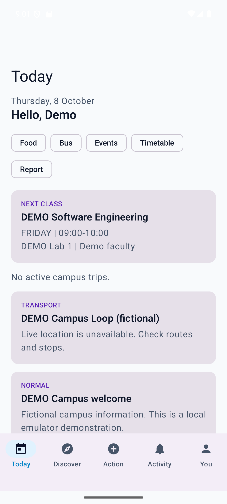
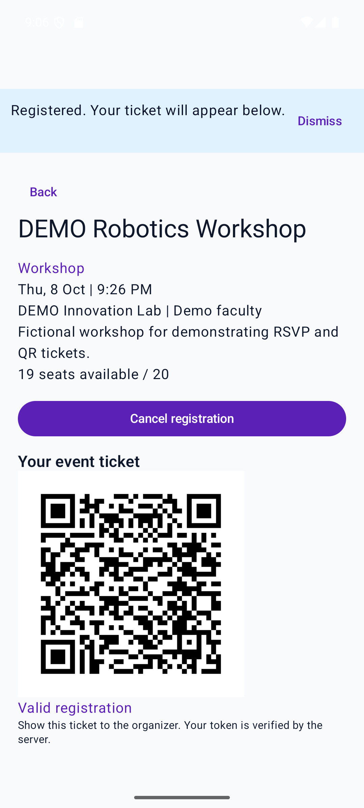
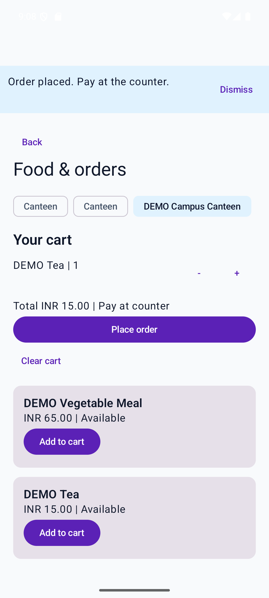

# Civora

An Android campus app built with Kotlin, Jetpack Compose and Firebase. A student can check their next class, register for an event, and order food for pickup. Campus staff use separate workspaces to check tickets, manage orders, and share bus locations.

[Run the emulator demo](demo/README.md) · [Browse all screens](demo/screenshots) · [Set up Firebase](#firebase-setup) · [Explore the tests](#testing)

| Plan the day | Carry an event ticket | Order from the canteen |
| :---: | :---: | :---: |
| [](demo/screenshots/04-today.png) | [](demo/screenshots/07-event-ticket.png) | [](demo/screenshots/08-food-cart.png) |

Captured on a Pixel 8 emulator running Android 15 with fictional campus data. The [deployment report](docs/LIVE_DEPLOYMENT_REPORT.md) records the local checks and remaining setup for live services.

## Follow an event ticket

A student registers for an upcoming event. A Cloud Function checks capacity, creates the registration and updates the seat count in one Firestore transaction. When faculty check the ticket, the backend checks the token, the organizer and the check-in window before recording attendance. A second scan cannot mark the same ticket twice. [Registration and check-in code](functions/workflows/events.js) · [Workflow tests](functions/test/workflows.integration.test.js)

## User roles

| Role | Access |
| --- | --- |
| Student | Public email registration; campus discovery, tickets, food orders, reports, profile |
| Faculty | Administrator provisioning; department content, own events and attendance |
| Admin | Trusted operator bootstrap; operations, invitations, reports and campus data |
| Vendor | Administrator provisioning; assigned canteens, menus and order transitions |
| Driver | Administrator provisioning; assigned bus, trip controls and foreground GPS |

Privileged authorization comes from Firebase Auth custom claims, never a user-editable profile or signup selection.

## Core features

- Today: next class, relevant active notice, registered upcoming event, latest trip and active food order.
- Timetable: daily and weekly schedules, rooms, next class and free periods.
- Announcements: exact department matching, categories, priority, expiry and document detail.
- Events: discovery, filters, registration/cancellation, My Events, transactional capacity and QR tickets.
- Food: canteen menus, single-canteen cart, server-priced orders, pickup tokens, status and history; pay at counter.
- Transport: routes/stops, assigned buses, active trip location, freshness and approximate ETA.
- Reports: categories, optional location/image URL, status tracking and administrator assignment/resolution.
- Discover: search over loaded campus content; structured clubs with follow/unfollow and related events.
- Inbox and activity: private durable history, unread notifications, links to affected entities and FCM delivery architecture.
- Campus locations: searchable places and external directions, without a Maps SDK key.

## Student experience

Bottom navigation is Today, Discover, Action, Activity and You. Complete department, year, section and bus route in You to personalize the daily overview. Missing campus data appears as an empty state; production screens do not seed invented classes, orders or trips.

## Architecture

`data/model` holds typed models and transition helpers; `data/repository` owns bounded Firestore listeners and callable requests; `data/datasource` owns foreground location and messaging. Feature screens live in separate `ui` packages. ViewModels expose immutable StateFlow state, retain list content on listener failures and offer retries. `CampusGateway` permits fake-backed ViewModel tests. Navigation Compose manages authentication and role workspaces; the student shell retains tab and module selection through saved state.

`functions/workflows` implements trusted transactional mutations. Firestore rules deny direct client workflow writes. This intentionally uses a small repository/ViewModel architecture rather than a large Clean Architecture scaffold.

## Tech stack

Kotlin, Jetpack Compose, Material 3, Navigation Compose, ViewModel, StateFlow, coroutines, Firebase Authentication, Cloud Firestore, Cloud Functions, Firebase Cloud Messaging, Google Play location services, Coil and ZXing. Android minimum API 26. Functions use Node 22.

## Firestore schema

| Collection | Main fields / ownership |
| --- | --- |
| users | UID, name, email, role mirror, department, year, section, routeId, profileImage, notificationsEnabled, createdAt |
| users/{uid}/devices | FCM token and updatedAt; own user only |
| announcements | title, body, category, priority, audience, department, authorId/name, createdAt, expiresAt |
| events | title, description, category, department, venue, startTime/endTime, organizer, createdBy, capacity, registeredCount, registrationEnabled, imageUrl, clubId |
| eventRegistrations | deterministic eventId_userId; userId, organizerId, random token, attended, createdAt |
| eventAttendance | registration ID; eventId, userId, organizerId, checkedBy, createdAt |
| timetables | courseId/name, faculty, dayOfWeek (ISO 1–7), startMinute/endMinute, room, department, year, section |
| canteens / menuItems | vendor assignment and opening; menu canteenId, pricePaise, availability |
| foodOrders | userId_requestId; vendorId, canteenId, priced items, totalPaise, token, status, paymentState, timestamps |
| buses / busRoutes | driverId, routeId; route name and embedded stops with coordinates |
| activeTrips | bus ID; assigned driver/route, active, timestamps and latest GPS fields |
| campusReports | createdBy, category, title, description, imageUrl, location, status, assignedTo, resolutionNote, timestamps |
| activities / notifications | userId, title/body, type, status, destination, entityId, createdAt; inbox adds category/read |
| clubs / clubFollowers | structured club metadata; deterministic clubId_userId follower record |
| campusLocations | name, category, description, latitude/longitude |
| roleAudit | trusted invitation actor, target, role and timestamp |

Money uses integer paise. Backend timestamps use server timestamps; client time is used only for display and schedule calculations. Queries are limited to 100 rows (legacy registered-ID helper: 200); filters are scoped by user, assignment or academic details. Required composite indexes are in `firestore.indexes.json`. Campus-readable department information is not confidential; this deployment assumes one campus per Firebase project. See [security assumptions](docs/SECURITY.md) and [audit](docs/AUDIT.md).

## Firebase setup

1. Create/select your Firebase project, register Android package `com.sachinkanna.civora`, enable Email/Password Authentication and create Firestore.
2. Place the downloaded configuration at `app/google-services.json` (ignored by Git). Without it, the app displays a configuration message instead of crashing.
3. Install backend dependencies: `npm --prefix functions ci`.
4. Sign in with Firebase CLI and deploy to the intended project: `npx firebase-tools deploy --project YOUR_PROJECT_ID --only firestore,functions`. Functions use `us-central1`; billing may be needed for deployment.
5. Register the first administrator as a normal user, then run `node functions/scripts/bootstrap-admin.js ADMIN_UID` with trusted Application Default Credentials and `GCLOUD_PROJECT` pointing to the project. Sign out/in to refresh claims. Never embed operator credentials in Android.
6. Use the administrator workspace to invite faculty/vendors/drivers and populate campus content, schedules, canteens, menus, routes and bus assignments. Send generated account setup links through your institution's trusted channel.

For existing data, back up the database, pause registration writes and run `functions/scripts/migrate.js` with trusted credentials before switching rules. Do not promote legacy self-selected roles to claims. Review migration output and orphan registrations before reopening writes.

## How to run

Open in Android Studio with Android SDK 36.1 installed and use the Gradle wrapper. Run `./gradlew assembleDebug` (Windows: `./gradlew.bat assembleDebug`). The debug APK is `app/build/outputs/apk/debug/app-debug.apk`.

For a populated local demonstration, follow the [emulator walkthrough](demo/README.md). It includes the seed step, the PowerShell commands used for ADB port forwarding, and separate student and staff accounts. The emulator host override applies to debug builds. For a live project, populate campus data through the app and its trusted workflows.

## Required manual configuration

MANUAL SETUP REQUIRED: connect the Firebase project and deploy as above, bootstrap the verified administrator, then enter real campus data. Configure Android App Check attestation and enforce callable protection as part of your release policy; it is not enabled blindly in this prototype. FCM needs the Android Firebase configuration, working Google Play services and notification permission on Android 13+. The inbox remains available without push permission. No Google Maps key is required for external directions.

GPS device validation: assign a driver to a bus/route, sign in, grant location permission, start the trip and keep the driver screen open. Check timestamps from a student account. Denying permission or leaving the screen pauses sharing; ending the trip clears active availability. Debug builds accept emulator mock locations; release builds reject them. Writes are throttled to 15 seconds and stale locations do not produce ETA.

## Testing

```sh
./gradlew test
./gradlew assembleDebug
npm --prefix functions test
npx firebase-tools emulators:exec --project demo-civora --only auth,firestore,functions "npm --prefix functions test"
```

The plain Node command runs policy tests and skips emulator checks when emulator environment variables are absent. The emulator command exercises rules and authenticated callable workflows, including racing for the final event seat, ticket replay rejection, authoritative menu pricing, report transitions and driver ownership. Android tests cover roles/registration, filters, timetable gaps/next class, status transitions, ETA and fake-backed ViewModel recovery/cart behavior. Instrumentation requires a connected Android device: `./gradlew connectedDebugAndroidTest`.

## Screenshots

The [screenshot gallery](demo/screenshots) covers the student app and the [admin](demo/screenshots/14-admin-dashboard.png), [vendor](demo/screenshots/15-vendor-dashboard.png), [driver](demo/screenshots/16-driver-dashboard.png) and [faculty](demo/screenshots/17-faculty-dashboard.png) workspaces. The emulator uses fictional accounts. The bus screen demonstrates the empty location state.

## Roadmap

- Embedded camera QR scanning (current attendance accepts a scanned/pasted ticket payload and validates it securely).
- Image uploads (current optional images use HTTPS URLs), embedded map and institution identity admission.
- Pagination beyond bounded recent feeds and background driver tracking with a foreground service.
- Automated invitation email delivery and production App Check/rate limiting policy.

No payment gateway, LMS, social feed or chatbot is included. Firestore cache supports browsing through temporary disconnection; sensitive actions need a connection. ETA is a distance-based approximation to a selected stop, not traffic-aware routing. Real push delivery, GPS accuracy and all role UI flows still require validation on a configured device.
